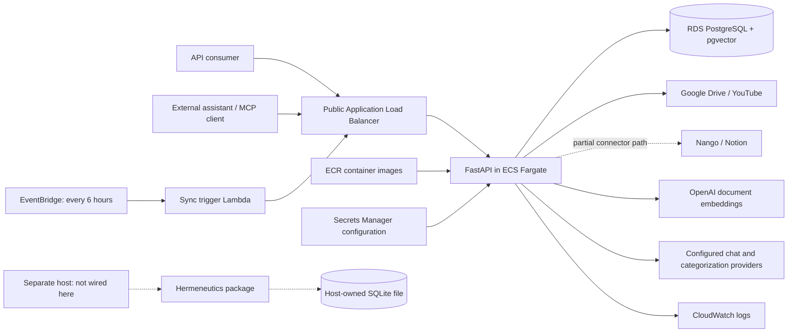
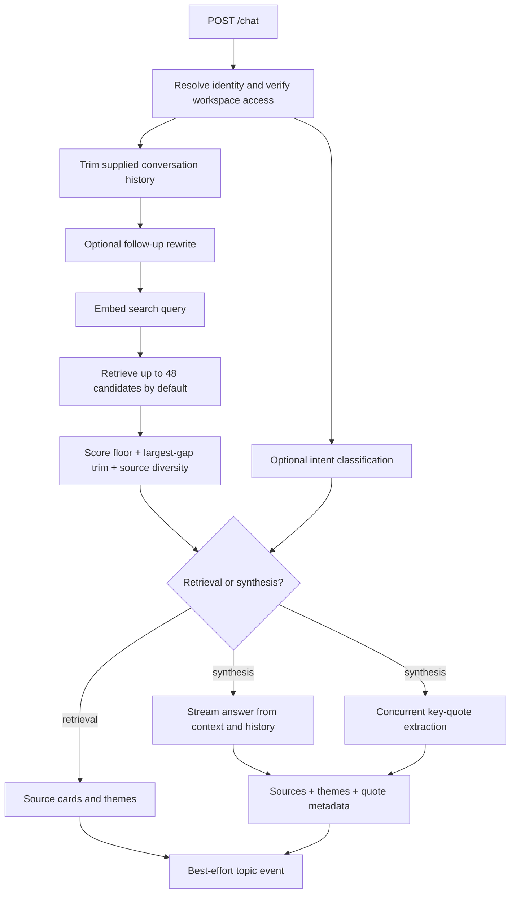

# Poysis backend architecture

Working-tree reference, 14 September 2026. Scope: this backend and its infrastructure. Intended use: recreate the system in FigJam and define its future API-platform boundaries.

Poysis is currently a **modular Python/FastAPI application with in-process background work**, backed by PostgreSQL/pgvector and external model APIs. Most capabilities share one deployment, one application worker per container, and one database. A separate interpretation package exists but has no route or deployment wired into this application.

## How to read this document

| Label | Meaning |
|---|---|
| CODE | Implemented in the files inspected; not proof it is deployed or working in production. |
| CONFIG | Declared by infrastructure/deployment configuration; not a live AWS inventory. |
| LOCAL | Present in uncommitted/untracked working-tree changes at the time of this review. |
| PARTIAL | Implementation exists, but wiring, compatibility, or coverage is incomplete. |
| UNKNOWN | Requires runtime inspection, measurements, or a product decision. |
| PROPOSED | A possible future boundary, not something running today. |

The marketing router and primitives, their migrations, and the `hermeneutics` package were local changes during this review. `main.py` and the retrieval router also had local modifications. This document includes them deliberately; it must not be read as a description of the currently deployed commit.

No live AWS resources, database rows, actual bills, model access, or secret values were inspected. Credential provisioning and secret rotation are outside this static architecture review. Runtime configuration is described only where declared in source. Older README/runbook descriptions were treated as historical context, not authority over executable code.

Companion documents:

- [FigJam blueprint](FIGJAM_BLUEPRINT.md): frame layout, component IDs, and arrow connections.
- [API inventory](API_INVENTORY.md): all 60 explicitly mounted routes, handler input contracts, and router-local request models.
- [Declared database schema](DATA_SCHEMA.md): table, index, extension, and alteration declarations extracted from migrations. It preserves conflicting historical declarations instead of inventing a resolved live schema.
- [Shared data contracts](DATA_CONTRACTS.md): internal source/chunk types, marketing rules/reports, and interpretation/evidence fields.
- [Code findings and unresolved questions](FINDINGS.md): differences that affect how the map should be drawn and how the API platform could evolve.

## 1. System boundary



External callers are abstract actors here. Frontend hosting, frontend persistence, and frontend business logic are out of scope. The diagram does not imply that the optional hermeneutics host currently exists.

There is no independently deployed embedding server, vector database service, topic service, or queue worker in the inspected AWS configuration. Document vectors and application records share RDS. The separate Titan classifier calls an external embedding model; it is not the document embedding pipeline.

## 2. Deployment and network topology

Sources: [CDK entrypoint](../../infra/app.py), [network stack](../../infra/poysis_infra/network_stack.py), [data stack](../../infra/poysis_infra/data_stack.py), [application stack](../../infra/poysis_infra/app_stack.py), [Dockerfile](../../Dockerfile).

| Component | Declared configuration | Diagram implication |
|---|---|---|
| Infrastructure definition | AWS CDK in Python; stacks `PoisysNetwork`, `PoisysSecrets`, `PoisysData`, `PoisysApp` | Draw deployment ownership separately from runtime request arrows. |
| AWS region | CDK defaults to `us-east-1`; workflow explicitly uses it | Configured region, not verified live location. |
| VPC | Up to 2 availability zones | AZ coverage does not mean two active application replicas. |
| Public subnets | `/24` per selected AZ | ALB and Fargate tasks sit here. |
| Isolated subnets | `/24` per selected AZ | RDS sits here. |
| NAT gateways | `0` | Task internet egress uses assigned public IPs. |
| Task network access | Public IP; all outbound allowed; inbound port `8000` from ALB security group | Public IP does not mean a declared public application ingress rule. |
| RDS network access | Port `5432` from VPC CIDR; outbound disabled on its security group | Current rule covers the VPC, not only the task security group. |
| ALB | Internet-facing, application target on port `8000` | Public API entry point. |
| TLS | HTTPS `443` if `certificate_arn` context is supplied; otherwise HTTP `80` | Draw HTTPS as conditional until deployment context is confirmed. |
| HTTP redirect | Additional `http_redirect` context flag | Do not infer redirect is enabled from HTTPS support alone. |
| API domain | Default `api.poysis.com`; DNS described as externally managed | No Route 53 zone resource was found in these stacks. |
| ECS cluster | `poysis`, Container Insights enabled | Container orchestration and metrics. |
| ECS service | `poysis-worker`, desired count `1` | One long-running application container per task. |
| Task compute | `1024` CPU units / `2048 MiB` memory | 1 vCPU and 2 GiB task memory, shared by all modules. |
| Scaling | Minimum 1, maximum 3 tasks; CPU target 70% | Scale-in cooldown 120s; scale-out cooldown 60s. |
| Rollout protection | Deployment circuit breaker with rollback | Health-based deployment recovery, not job recovery. |
| ECS Exec | Enabled | Operational access path from a task to the isolated database. |
| Container base | `python:3.11-slim`; non-root UID/GID 1001 | No dedicated GPU or local language model declared. |
| Process manager | Gunicorn, Uvicorn worker class, `--workers 1` | Each task runs one application worker process. |
| Process timeouts | Worker timeout disabled (`0`); graceful timeout 30s; keepalive 5s | Long requests permitted; deployment can still interrupt background work. |
| Container health | `curl /ping`, interval 30s, timeout 10s, retries 3, start period 60s | Checks process responsiveness. |
| Service health | Grace period 120s | Separate from container start period. |
| ALB health | `/ping`, interval 30s, timeout 10s, healthy 2 / unhealthy 3 | `/ping` does not test DB connectivity or model availability. |
| Application logs | `/ecs/poysis-worker`, one-month retention | Application stdout/stderr. |
| Network logs | Rejected VPC traffic flow logs configured | Not an all-traffic audit trail. |

Draw the ALB and task subnet boundary separately from the RDS subnet boundary. External source/model requests leave the task through public egress. Database calls remain inside the VPC. No S3 document archive, Redis cache, SQS queue, API Gateway, or separately deployed inference worker is declared in these application stacks.

## 3. Application composition and request lifecycle

Source: [main.py](../../main.py), [middleware](../../app/middleware.py).

The executable layers are:

| Layer | Main components | Responsibility |
|---|---|---|
| HTTP boundary | FastAPI routers | Parse inputs, apply route-specific access checks, format JSON/streams. |
| Product orchestration | Consolidation, chat, sources, MCP, marketing, admin, Ouroboros | Coordinate a user-facing operation. |
| Reusable capabilities | `KnowledgeEngine`, `VectorService`, `DatabaseService`, processors/connectors | Embedding, parsing, search, persistence, provider access. |
| Domain rules | Retrieval filtering, categorization, marketing rules | Decide which results to keep and how to organize them. |
| External dependencies | PostgreSQL, model APIs, source APIs | Persistence and network work. |

The logical inbound middleware order, derived from registration, is:

`CORS -> input validation -> rate limiting -> logging -> error handling -> route dependencies -> handler`.

Responses return through the wrapping layers. The source comment about registration order is misleading; middleware added later wraps middleware added earlier.

| Boundary behavior | Current implementation |
|---|---|
| CORS | Wildcard origins, methods, headers. |
| Request-size check | Rejects declared `Content-Length` above 10 MiB; not an independently enforced streamed-body cap. |
| Workspace query check | If query parameter `workspace_id` exists, it must be nonempty and at least 3 characters. Does not validate every body/path field. |
| Rate limiting | 100 requests/minute per `X-User-ID`, falling back to `anonymous`; in-memory per process. |
| Request logging | Method, path, header user ID, status, elapsed time. Streaming completion time is not comprehensively measured here. |
| Unhandled errors | Generic JSON 500 plus an in-process error ID. Some routes have their own different error behavior. |
| API documentation | FastAPI default `/docs`, `/redoc`, `/openapi.json`. |
| Versioning | No `/v1` namespace in mounted routes. |

Startup constructs several module-level services. `DatabaseService` creates its shared pool lazily; `VectorService` creates a pool in its constructor. The startup lifespan calls `reap_stale_jobs(stale_after_seconds=0)` before serving requests. This is operationally significant when more than one task exists: startup is not scoped to jobs owned by the starting process.

## 4. Public API capability map

Use a single outer **Poysis API** box with these inner capability groups. Do not draw each router as an independently deployed microservice.

| Capability | Route group | Principal output | Status |
|---|---|---|---|
| Document ingestion and search | `/retrieval/*` | Indexed vectors, matching passages, source lists, scoped counts | CODE; some implementation inconsistencies remain. |
| Source lifecycle | `/sources/*`, `/auth/*` | Source connections, redirect/callback flows, channel/playlist metadata | CODE; authorization differs by operation. |
| Snapshot orchestration | `/consolidation/discover`, `/snapshot`, status and stream routes | Source estimates, job IDs, progress, ingestion outcomes | CODE. |
| Topic organization | `/consolidation/cluster/*`, topics/stories/knowledge routes | Topic hierarchy and cross-topic narratives | CODE. |
| Chat | `POST /chat` | Retrieval-only results or streamed answer with source/meta markers | CODE. |
| Hosted MCP | `/mcp/{workspace_id}` | JSON-RPC tool results | CODE; retrieval is not backend answer generation. |
| Label classifier | `POST /classify/classify` | Label scores and threshold decision | CODE; no per-route identity dependency. |
| Legacy clustering block | `POST /cluster/cluster` | Intended similarity buckets | PARTIAL; incompatible engine call. |
| Legacy recommendation block | `POST /recommend/recommend` | Intended similar-item recommendations | PARTIAL; incompatible engine call. |
| Marketing observations and rules | `/marketing/*` | Structured reports, editable rules, review opportunities | LOCAL, mounted by local `main.py`. |
| Event tracking / analytics | `/track/*`, `/analytics/*` | Attribution writes, dashboard/log reads | CODE; contains predecessor-era contracts. |
| Build suggestions | `/ouroboros/build-promises/{workspace_id}` | Suggested bot templates based on topics/stories | CODE; direct Gemini call. |
| Admin inspection | `/admin/whoami`, `/admin/bots` | Admin identity and channel workspace/vector counts | CODE. |
| Waitlist | `POST /waitlist` | Normalized email persistence | CODE; intentionally public input. |
| Interpretation service core | Python `hermeneutics` interface | Evidence-backed interpretations and durable jobs | LOCAL; no mounted HTTP route. |

The repeated names `/classify/classify`, `/cluster/cluster`, `/recommend/recommend` are the actual combined mount paths. The newer categorization flow is under `/consolidation/cluster/{workspace_id}` and is a different implementation.

See [API_INVENTORY.md](API_INVENTORY.md) for every method, path, handler, and input definition. A route being mounted is not a claim that its internal flow succeeds.

## 5. Identity, tenancy, and scope boundaries

Sources: [access checks](../../app/api/security.py), [source routes](../../app/api/sources.py), [MCP](../../app/api/mcp_http.py), [marketing routes](../../app/api/marketing.py).

Draw four different concepts:

1. **Caller identity:** resolved by the route's identity dependency where present.
2. **Workspace membership:** checked against `workspace_members`, with a legacy owner fallback through `workspaces.user_id`.
3. **Retrieval scope:** optional connection IDs and topic IDs limiting content within an authorized workspace.
4. **Administrator/owner role:** additional checks for privileged source, seeding, and rule-editing operations.

`verify_workspace_ownership` is an alias for `verify_workspace_access`; despite its name, it allows members, not only the owner. The owner fallback auto-adds an owner membership row. Some source routes separately compare `workspaces.user_id`, so their behavior is owner-only rather than membership-wide.

The identity implementation supports verified bearer JWTs, with configurable signature verification, issuer, and audience. It also retains an unverified `X-User-ID` fallback, enabled by default unless explicitly disabled. The inspected task environment does not declare the corresponding `AUTH_*` settings. Actual production identity behavior is therefore UNKNOWN, not confirmed hardened authentication.

Hosted MCP has a separate workspace credential check. Draw its access boundary separately from REST user identity. No credential values are part of this map.

| Scope identifier | Meaning and representation |
|---|---|
| `workspace_id` | Application tenant boundary, generally TEXT. |
| `workspaces.id` | UUID row ID, separate from the public workspace string. |
| `user_id` | Identity subject or accepted legacy header value. |
| `notebook_id` | Legacy API name for a vector namespace; it is not a separate database notebook entity here. |
| `consolidation_{workspace_id}` | Main namespace used for both normal documents and YouTube transcripts. |
| `source_id` | Upstream file/video/page ID. |
| `connection_id` | A connected source record ID; YouTube's mapping uses `youtube_channels.id`. |
| `topic_id` | Integer category identifier, meaningful within a workspace. |
| `category_id` | Topic/category ID stored inside vector metadata by categorization. |
| `client_id` | Additional scope in the separate hermeneutics package; not yet a shared REST-platform tenant boundary. |

For connection/topic filters, `None` means unrestricted within the workspace and `[]` means no allowed content. Chat accepts these filters from its caller. The handler does not resolve a stored bot grant and intersect the caller's selection with that grant. For an externally shared API, selection and authorization need distinct boxes.

Authorization is not uniform across all mounted routes. Some topics/analytics endpoints lack the identity dependency; some older paths catch access failures and continue. Those are recorded in [FINDINGS.md](FINDINGS.md). Do not draw a universal authentication gateway that the implementation does not have.

## 6. Source connectors and normalized content

Sources: [scope](../../app/primitives/consolidation/scope.py), [connector contracts](../../app/primitives/consolidation/connectors/base.py), [snapshot runner](../../app/primitives/consolidation/snapshot.py).

The pipeline separates upstream discovery from content normalization:

`ScopeConfig -> connector.list_items -> RawSourceItem -> fetch_text/fetch_file/fetch_segments -> processor -> ProcessedChunk`.

| Object | Key fields |
|---|---|
| `ScopeConfig` | Workspace, requested sources, time window, document limit, Drive folders, indexed-file ETags, internal Nango providers, YouTube channel IDs and connection mapping, minimum video duration. |
| `RawSourceItem` | Source ID/type, title, URL, ETag, modified time, content type, optional MIME/fetch URL/size/connection ID. |
| `ProcessedChunk` | Text, source ID/type, title, URL, optional start/end milliseconds, extra metadata. |
| Stored vector | Chunk ID, namespace, embedding, JSONB metadata including `_text`. |

The broad source vocabulary in `RawSourceItem` includes placeholders. Public `SnapshotRequest.sources` currently accepts only `google_drive` and `youtube`.

### Google Drive

- Uses Drive API v3; lists supported files with pagination of up to 100 entries.
- Filters trashed files, optional modified-time window, optional immediate parent folders, and supported MIME types.
- `modifiedTime` acts as the incremental ETag.
- Google Docs and Slides export as plain text; Sheets export as CSV.
- Binary PDF, CSV/Excel, DOCX, and PPTX are downloaded to temporary files.
- Listing/text requests use 60s HTTP timeout; binary fetch uses 120s.
- Fetch/parse concurrency is five documents per runner.
- Files reported as at least 5 MiB are marked orphaned rather than ingested by the snapshot path.
- Original files are retained at the upstream provider; temporary local downloads are removed after processing.

No recursive traversal of descendant folders is implemented by the parent-filter query itself. No persistent blob archive is declared in this path.

### YouTube

- Uses YouTube Data API v3 for channel resolution, upload enumeration, durations, playlist metadata, and playlist membership.
- Captions use `youtube-transcript-api` by default; `YT_CAPTIONS_BACKEND=ytdlp` selects the alternative implementation.
- Both caption paths support an optional configured proxy. The task definition inspected does not explicitly set `YT_CAPTIONS_BACKEND`.
- The library path retries errors containing `429` up to four attempts, waiting 30/60/120s between retries.
- Runner concurrency is one video; it waits three seconds after each fetch attempt.
- Scope default minimum duration is 2,700 seconds / 45 minutes. Saved channel thresholds can override it in the snapshot route; multiple channels use the lowest nonzero saved threshold for the entire run.
- Direct `POST /consolidation/youtube/ingest_transcript` accepts already-fetched timed segments and bypasses upstream caption fetching.
- This is caption ingestion, not speech-to-text transcription of downloaded audio. No Whisper/Transcribe processing is wired here.

### Notion and Nango

- A Notion connector exists behind the Nango-managed connection abstraction.
- Notion page discovery and block-to-text traversal are implemented; the runner has an internal `nango_sources` path.
- Public `SnapshotRequest` neither accepts `notion` as a source nor exposes `nango_sources`, and the route does not populate it from saved connections.
- Draw **Notion ingestion as partially wired**, with a dashed arrow to the snapshot pipeline.
- Slack/GitHub/calendar/mail names appear in generic types or historical docs but are not implemented snapshot connectors in the registry.

## 7. Ingestion and indexing flows

Sources: [consolidation API](../../app/api/consolidation.py), [consolidation engine](../../app/primitives/consolidation/engine.py), [knowledge engine](../../app/primitives/knowledge/engine.py).

### Snapshot operation

```mermaid
sequenceDiagram
    participant C as API consumer
    participant A as Consolidation router
    participant D as PostgreSQL
    participant J as In-process background task
    participant S as Source provider
    participant E as OpenAI embeddings
    C->>A: POST /consolidation/snapshot
    A->>D: Check access, existing job, source config and ETags
    A->>D: Create running job
    A-->>C: started + job_id
    A->>J: Schedule FastAPI BackgroundTasks function
    J->>S: List and fetch new/changed source items
    J->>J: Parse and batch chunks
    J->>E: Embed bounded batches
    E-->>J: 1536-dimensional vectors
    J->>D: Upsert vectors; record file checkpoints and progress
    opt Corpus changed and clustering enabled
        J->>J: Cluster and categorize
        J->>D: Save topics/stories and update vector metadata
    end
    J->>D: Finish job with counters and errors
    C->>A: GET snapshot/stream with job_id
    A->>D: Poll job row
    A-->>C: SSE progress and completion events
```

Snapshot request defaults: required nonempty `sources`, `time_window_days=0`, `doc_limit=10000`, no folder restriction, clustering enabled. `ScopeConfig` independently defaults its document limit to 500 for internal callers. `cluster_instructions` is accepted/carried but is not used by the inspected categorization algorithm.

The job loop can repeat a partial snapshot after refreshing indexed-file state. Its listing limit and pagination do not constitute a durable cursor across jobs. In particular, repeatedly listing the same first page range can stop progress beyond the limit once those files are already indexed.

### Incremental behavior and file state

| Condition | Behavior |
|---|---|
| Stored ETag equals current source ETag | Skip file. |
| Matching `ORPHANED:` ETag in Drive/YouTube path | Skip repeated fetch of that version. |
| Drive file is too large | Record orphaned ETag and error. |
| Per-file fetch or parse failure | Record failure/orphan marker; other files continue. |
| Successful vector batch | Flush completed-file records to `consolidation_indexed_files`. |
| Batch/model/database failure | Overall job can fail; prior committed batches remain. |
| No new docs or orphaned docs counted | Automatic clustering skipped. |
| `skip_clustering=true` | Index only; explicit clustering can run later. |

There is no inspected transactional source-version replacement that deletes all previous chunks before committing the new version. Disconnecting a source is not equivalent to purging its indexed content. Incremental skip logic is not a complete deletion reconciliation system.

### Document processing and chunks

| Source path | Initial processing | Subsequent stored-chunk processing |
|---|---|---|
| Google Docs/Slides and Notion text | Paragraph grouping targeting 1,600 characters; a long paragraph can exceed the target | LlamaIndex `SentenceSplitter(chunk_size=512, chunk_overlap=50)`. |
| Snapshot PDF | Local PyMuPDF parser, page text + page metadata | Same 512-token splitter. |
| Snapshot spreadsheet | One row converted to text + row metadata | Same splitter; `_to_documents` currently preserves common metadata and PDF page fields, not every extra row field. |
| Snapshot Office file | `SimpleDirectoryReader`, combined extracted text | Paragraph grouping then same splitter. |
| Direct JSON ingestion | LlamaIndex Documents from supplied content | Same splitter. |
| Direct file upload | Temporary file; reader selected by extension | Same ingestion pipeline; optional LlamaParse for direct PDF uploads. |
| YouTube transcript | Timed segment windows around 60s, timestamped text | Two embedding passes and semantic merging; bypasses SentenceSplitter. |

The 512/50 values are configured tokenizer budgets, not a promise that every stored passage has exactly 512 text tokens. Metadata and parser boundaries can change effective text size. Also, `MAX_CHUNKS_PER_DOC=2000` is a warning threshold in the actual runner; despite older wording it does not cap chunks there.

Direct upload supports `.pdf`, `.xlsx`, `.xls`, `.csv`, `.txt`, `.docx`. Snapshot Office support additionally includes PPTX. These are different entry points with different validation and parsing behavior.

### Embedding mechanics

| Setting | Current value |
|---|---|
| Document and query model | `text-embedding-3-small`, direct OpenAI embedding client. |
| Stored dimensions | 1,536; declared column `vector(1536)`. |
| Dimension override | None supplied to the document embedding client. |
| Client batch setting | `embed_batch_size=512`. |
| Actual outer embedding sub-batch | 200 texts, processed sequentially by `_embed_batch`. |
| Consolidation chunk buffer | 200 preprocessed chunks before a flush. |
| Database write batch | 100 vectors. |
| Embedding input guard | Truncate individual input to 8,000 tokens; fallback estimate 4 characters/token if tokenizer unavailable. |
| Embedding retries | Up to five attempts for errors containing `429`; waits 30/60/120/240s. Other errors raise. |
| Stored content | Embedding plus `_text` and provenance inside JSONB metadata. |

Source fetches can continue while embedding waits, but the runner's queues and scheduled task lists are unbounded. Five concurrent fetches does not enforce a five-document total memory bound: parsed results can accumulate faster than they are embedded.

### Transcript-specific processing

1. Timestamp source segments and group them into approximately 60-second pre-chunks.
2. Embed all pre-chunks with the same 1,536-dimensional document model.
3. Compute adjacent embedding dot products, smooth over a window of 3, and split where similarity is below `0.75`.
4. Merge adjacent same-topic pre-chunks, targeting a 6,000-token budget per merged chunk.
5. Embed the merged chunks again. These second-pass embeddings are persisted.
6. Store timestamp fields and a URL containing the starting time.

This doubles the main text-embedding stages for transcripts. Pre-chunk embeddings are temporary. The merger is invoked on pipeline batches and does not explicitly enforce a video/source-ID boundary; this is a correctness boundary to review. A single oversized pre-chunk can also exceed the merge target and meet the later truncation guard.

## 8. Vector storage and retrieval

Source: [VectorService](../../app/primitives/knowledge/vector_store.py).

The conceptual row is:

```text
vectors
  id: text
  namespace: text
  embedding: vector(1536)
  metadata: jsonb
    _text
    source_id, source_type, title, url
    page, total_pages                       # where applicable
    connection_id                          # where stamped by ingestion
    timestamp_start_ms, timestamp_end_ms    # transcripts
    start_time, end_time, start_seconds     # transcripts
    category_id, category_label             # after categorization
  primary key: (id, namespace)
```

No separate persistent chunk-text table is required for retrieval. `KnowledgeEngine.fetch_raw` returns `_text` as top-level `text` and removes it from returned metadata.

Search flow:

`query text -> OpenAI query embedding -> SQL namespace/metadata filters -> cosine-distance order -> score sorting -> endpoint-specific policy`.

The SQL score is `1 - (embedding <=> query_vector)`, not a calibrated probability. SQL filters can cover namespace, legacy `topic_id`, source types, category IDs, and connection IDs. The legacy singular topic field and newer category field are not interchangeable.

| Retrieval setting | Meaning |
|---|---|
| SQL candidate limit | `max(requested_top_k, 50)`; 50 is a minimum pool size, despite the constant's name `_CANDIDATE_CEILING`. |
| HNSW query option | `SET LOCAL hnsw.iterative_scan = relaxed_order`. |
| Final ordering | Python re-sorts by descending score before returning up to requested `top_k`. |
| Declared/manual index recipe | HNSW with `vector_cosine_ops`, `m=16`, `ef_construction=64`, in migration comments. |
| Index creation | Recipe is not executed by the extracted baseline migration SQL; live existence and extension version need verification. |
| Gap filter | Cut at the largest adjacent score gap while retaining at least the requested minimum number if available. No gap-magnitude threshold. |

Database calls in `fetch_raw` are sent to a thread through `asyncio.to_thread`. Some other synchronous vector calls remain directly inside async route handlers.

`DatabaseService` shares a process-wide 1-to-10 connection pool. Each `VectorService` instance owns a separate 1-to-10 pool and a write semaphore of 10. The shared knowledge engine limits repeated construction in some paths; retrieval/admin paths still instantiate additional services. Do not model the whole application as having a single global maximum of ten database connections.

## 9. Chat execution and model calls

Source: [chat router](../../app/api/chat.py).

Default chat request: `top_k=8`, `min_score=0.4`, temperature `0.4`, maximum output tokens `800`, tier `quick` when unspecified, automatic mode classification, `sources_first=false`.



Retrieval asks the engine for `top_k * 6` candidates: 48 at default settings. The vector store queries at least 50 SQL candidates, then returns up to 48. Chat filters scores below 0.4, applies the largest-gap trim, and round-robins across source-ID buckets to select up to eight passages. Diversity is a selection heuristic, not a guarantee of eight distinct sources.

The selected full chunk texts become the answer context. There is no separate hard total context-token budget in this handler. Eight transcript passages can be much larger than eight 512-token document passages. The 800-token setting limits requested output, not input context or total request cost.

### Conversation and output contracts

- Caller owns conversation history; no server-side conversation thread store is used by `/chat`.
- At most 20 history turns are accepted; only the last six are retained.
- Prior assistant turns are truncated to 300 characters. User turns do not receive the same per-turn truncation.
- Follow-up rewriting runs only when retained history exists; it requests up to 60 output tokens and discards a rewrite above 400 characters or empty output.
- An optional caller mode skips intent classification; classification requests up to five output tokens and defaults to synthesis on errors.
- Synthesis combines the grounding/persona system instructions, retained history, selected source text, and the current original question.
- Key-quote extraction runs concurrently with answer generation, requests up to 256 tokens, and uses a word-overlap check of at least 0.6 with a retrieved passage. This is a heuristic, not semantic proof of quotation fidelity.
- Themes come from persisted topic metadata, up to six unique themes, without a new model call.
- Completed nonempty responses schedule a best-effort `topic_query_events` write; no-result early returns do not reach that write.

The chat response has media type `text/event-stream` but emits raw text plus markers: `__MODE__`, `__SOURCES__`, `__META__`, `__ERROR__`. It does not use the same `data: ...\n\n` framing as the snapshot SSE endpoint. Consumers need a custom parser and must handle markers split across network chunks.

### Model/provider configuration

| Work | Code/config selection | Requested output budget |
|---|---|---|
| Document/query embeddings | Direct OpenAI `text-embedding-3-small` | Embedding vectors. |
| AWS chat tiers | All three tiers select `BEDROCK_CHAT_MODEL` when `BEDROCK_OPENAI_BASE` is set | Default answer 800 tokens. |
| Configured task chat model string | `openai.gpt-5.6-luna` | Exact literal from CDK, not verified provider availability. |
| Python default chat model string | `openai.gpt-5-6-luna` | Differs from the CDK literal; environment normally overrides it. |
| Local/direct quick tier | `gpt-4.1-mini` | Caller/default answer budget. |
| Local/direct thinking/expert | `gpt-4.1` | Caller/default answer budget. |
| Utility model | Configured Bedrock chat model, otherwise `gpt-4.1-mini` | Intent 5, rewrite 60, quote 256. |
| Categorization | `anthropic.claude-3-5-haiku-20241022-v1:0` via Bedrock | Wrapper requests `max_tokens=4096`. |
| Categorization local fallback | `gemini-3.1-flash-lite-preview` | Provider configuration. |
| Label classifier on AWS | Titan V2, 1,024 dimensions, normalized | Two embedding calls per supplied label in current loop. |
| Label classifier local fallback | `models/gemini-embedding-001` | Dimensions not overridden in that fallback. |
| Build suggestions | Direct Gemini, literal `gemini-3.5-flash` | Independent of chat provider routing. |
| Marketing target preview | Chat utility model | 2,200 output tokens, 30s timeout. |
| Hermeneutics | Host-injected strong model | Host must supply budget/version; package does not choose a provider. |

These are source literals and selection rules. Model validity, access, pricing, and actual successful runtime usage were not verified. The code's provider table includes DeepSeek, but none of the current tier mappings selects it. A configured missing-key fallback is not a tested cross-provider outage failover.

At default automatic mode, a first-turn synthesis with results uses one query embedding plus three generation calls: intent, answer, quote. A follow-up adds a rewrite call. Explicit retrieval mode with no history uses one query embedding and no generation call. Retrieval with automatic mode or history can still use utility generation calls.

## 10. Topic clustering, categorization, and playlists

Sources: [clustering orchestrator](../../app/primitives/consolidation/clustering.py), [embedding clustering](../../app/primitives/consolidation/embedding_cluster.py), [categorizer](../../app/primitives/consolidation/categorizer.py), [playlists](../../app/primitives/consolidation/playlists.py).

This is document-level clustering of existing vectors, followed by model-generated labels and summaries. The implemented grouping algorithm directly uses UMAP and HDBSCAN; the older BERTopic label in comments does not describe the actual call chain.

1. List source documents/snippets in the workspace namespace. Skip when fewer than ten documents exist.
2. Load existing topics, locked topic IDs, vector category assignments, and playlist membership.
3. Exclude documents belonging to locked categories from regrouping.
4. Compute a centroid per source document by averaging stored chunk embeddings in PostgreSQL. No new document embeddings are purchased for this step.
5. Normalize document centroids in Python and reduce them with UMAP to **5 dimensions**, cosine metric, random state 42. These five dimensions are temporary clustering coordinates, not the stored embedding size.
6. Sweep HDBSCAN minimum cluster sizes from `[3,4,5,6,8,10]`, restricted by `max(3, N//8)`.
7. If more than one candidate exists, ask the categorization model to select the most useful partition using titles/group sizes/noise summaries.
8. Ask the model to name fine groups and merge them toward 8-to-15 broader parent categories. This is a prompt target, not a guaranteed number of categories.
9. Preserve IDs for matching existing labels/parents; assign new IDs from current maximum plus one. Put unmatched/noise documents in `Unsorted`.
10. Carry locked topics and their document assignments forward.
11. Clear prior topic/story rows, run semantic analysis and story detection concurrently, then save the replacement rows.
12. Update vector metadata with `category_id` and `category_label`.

Semantic analysis uses up to five document samples per eligible topic and 400 characters per snippet. Calls within that analysis run topic by topic. Story detection is a separate call over topic IDs/labels/counts; its prompt requests up to seven stories with strength at least 0.7. Those prompt instructions are not strict numeric output validation in the implementation.

The hierarchy is primarily parent categories plus child groups. Story rows contain an ordered list of topic IDs and generated narrative metadata. There is no separately deployed graph database or graph traversal engine.

Potential cost per categorization run: partition-choice call when required + parent merge call when groups exist + per-topic semantic calls + story call. The compute sweep itself runs synchronously inside an async function; it can delay other requests on the shared event loop.

### Human-authored playlist categories

Playlist import reads channel playlist metadata, creates or reuses topic labels, writes `topic_documents`, locks topics in `topic_overrides`, and stamps existing vectors. It can make a topic browsable before captions are indexed. It does not restrict ingestion to those playlists; the snapshot still lists the channel. If a video belongs to several imported playlists, the relational membership can represent several topics but vector metadata currently stores one category ID.

Admin channel seeding creates a distinct workspace for a channel and schedules `seeding.ingest_and_cluster` through FastAPI BackgroundTasks. It reuses the consolidation/clustering engines but bypasses the regular snapshot route's job-record/progress wrapper. Its default minimum video duration is 600 seconds / 10 minutes and its internal document limit is 500. It is an alternate source-onboarding branch, not an independent service.

## 11. Hosted MCP and local MCP wrapper

Sources: [hosted MCP](../../app/api/mcp_http.py), [local wrapper](../../mcp_server.py).

Hosted implementation: JSON-RPC 2.0 over `/mcp/{workspace_id}`, protocol literal `2025-03-26`, server `poysis-knowledge` version `1.0.0`.

Methods include `initialize`, `tools/list`, `tools/call`, and initialization notification handling. Advertised tools:

| Tool | Implementation |
|---|---|
| `retrieve_from_knowledge_base` | Embed query; retrieve `2 * top_k`; filter default score 0.5; return up to default five passages. |
| `list_documents` | Read source titles/URLs/snippets and optionally filter title/source type. |
| `list_topics` | Read persisted topic hierarchy and semantic fields. |

The external assistant performs its own answer generation after receiving tools' evidence. The backend pays for query embedding and database work in its retrieval tool; it does not call `/chat` for this flow.

The endpoint validates workspace access through its own credential mechanism. It also treats absence of topics as a missing/not-consolidated workspace, so an indexed workspace with no clustering result can be unavailable over MCP.

The root `mcp_server.py` is a separate stdio wrapper intended to run beside a desktop client. It makes HTTP calls back to the worker's REST knowledge endpoints. It is not started by the Docker command and must be drawn as an optional external adapter. Its REST dependency inherits the compatibility findings in the retrieval API.

## 12. PostgreSQL data model

Source: [database methods](../../app/primitives/database.py), [migration baseline](../../scripts/migrate_db.py), [full declarations](DATA_SCHEMA.md).

| Group | Tables | Purpose / logical relationships |
|---|---|---|
| Tenant and roles | `workspaces`, `workspace_members`, `profiles` | Public workspace string, ownership/membership, administrator metadata. |
| Connection state | `consolidation_workspaces`, `drive_connections`, `nango_connections`, `youtube_channels` | Source-specific state tied to workspace/user/channel/provider. |
| Work tracking | `consolidation_jobs` | Job type, running/done/failed status, JSON result/progress, errors, timestamps. |
| File checkpoints | `consolidation_indexed_files` | Unique workspace + source ID, ETag/orphan status, source type. |
| Knowledge passages | `vectors` | Composite namespace/chunk ID, 1,536-dimensional embedding and metadata/text. |
| Topic hierarchy | `consolidation_topics` | Unique workspace + topic ID, parent topic, labels/counts/semantic fields. |
| Narrative organization | `consolidation_stories` | Unique workspace + story ID, ordered topic IDs, generated narrative/strength. |
| Human topic control | `topic_overrides`, `topic_documents` | Locks/custom labels and playlist membership, including unindexed videos. |
| MCP access metadata | `mcp_tokens` | One active workspace credential hash record. |
| Product events | `search_logs`, `attribution_events`, `topic_query_events` | Search, predecessor-style attribution, and chat topic/source events. |
| Marketing observations | `marketing_observations` | Daily facts separated by source/property/dataset/dimension combination. |
| Marketing settings | `marketing_rules` | Versioned editable rule config and editor metadata. |
| Research snapshots | `marketing_keyword_planner_reports` | Immutable report identity and normalized JSON report content. |
| Signup leads | `waitlist` | Unique email and optional source. |

Most workspace relationships are application-managed TEXT identifiers, not foreign keys. `workspace_members` does declare a workspace FK; attribution declares a search-log FK. Topic parent/story references and vector namespace/category references are logical links. Draw those as logical relations rather than claiming DB-enforced referential integrity everywhere.

`topic_overrides.topic_id` is TEXT in the migration baseline while topic IDs are INTEGER elsewhere. Historical migrations also use different semantic-field types from the baseline (arrays versus JSONB). The schema appendix preserves those differences; only inspecting the deployed schema would resolve them.

### RDS configuration

| Setting | Declared value |
|---|---|
| Engine | PostgreSQL `16.4` in CDK. |
| Instance | `db.t4g.small`. |
| Storage | 100 GiB allocated gp3; autoscaling maximum 500 GiB. |
| Database | `poysis`. |
| Encryption | Storage encryption enabled. |
| Availability | Single-AZ database (`multi_az=False`). |
| Backup retention | **1 day** in executable configuration; header comment says seven days. |
| Deletion handling | Deletion protection enabled; retain removal policy. |
| Monitoring | Performance Insights enabled; enhanced monitoring every 60 seconds. |
| Parameter group | `pg_stat_statements` preload; `work_mem=32768` KB; `max_parallel_workers_per_gather=2`. |

The `vector` extension is created by migration SQL. The task configuration alone does not prove schema migrations or the HNSW index have been applied.

### Storage sizing for discussions

For a raw float32-value estimate: `1,536 dimensions * 4 bytes = 6,144 bytes` per vector's numeric values. This excludes the vector container, PostgreSQL tuples/pages, IDs, namespace strings, JSONB text/metadata, indexes, WAL, backups, and temporary query/cluster memory.

| Illustration | Raw vector-value estimate |
|---|---|
| 1,800 documents at 1 chunk each | About 10.55 MiB. |
| 1,800 documents at 10 chunks each | About 105.47 MiB. |
| 1,800 documents at 100 chunks each | About 1.03 GiB. |

These are arithmetic scenarios, not measured corpus sizes. Provisioned RDS storage, consumed disk, application RAM, and clustering memory are different quantities. The transcript two-pass pipeline increases embedding work without storing both passes.

## 13. Structured marketing subsystem

Sources: [service](../../app/primitives/marketing/service.py), [store](../../app/primitives/marketing/store.py), [rules](../../app/primitives/marketing/rules.py), [target interpreter](../../app/primitives/marketing/targets.py), [planner normalization](../../app/primitives/marketing/keyword_planner.py).

This subsystem separates numeric observations from semantic document search. Its use of the word **dimensions** means business fields such as query/page/device/country, not vector dimensions.

```text
Host-supplied GA4/Search Console report
  -> deterministic parser
  -> Observation(day, dimensions, metrics)
  -> MarketingService.ingest
  -> marketing_observations
  -> scoped reads / deterministic opportunity evaluation

Natural-language target
  -> utility model preview
  -> validated rule or clarification questions
  -> explicit owner save with expected revision
  -> marketing_rules

Supplied Keyword Planner report
  -> normalize and fingerprint
  -> immutable report snapshot
  -> list/filter research keywords
```

No recurring GA4/Search Console fetcher or public generic observation-ingest endpoint is mounted here. Report parsers and the internal `ingest` method exist; the calling host must supply reports. Keyword Planner import does have a public API route. Do not draw a continuously running Google Analytics connector based on parser existence.

Observation identity: workspace + source + property + dataset + day + SHA-256 of canonical dimension JSON. Re-ingestion replaces observations instead of adding counts. Duplicate grains within one batch are rejected.

Opportunity evaluation supports `search_snippet_review`: group by complete dimension combination, sum clicks/impressions, recompute CTR, and use impression-weighted position. Default thresholds are 100 impressions, CTR below 0.02, positions 1 through 10, rolling 28-day window. It returns heuristic review candidates, not revenue predictions or causal explanations.

Marketing reads constrain date windows to at most 366 days; default pagination is 100 and maximum page size 1,000. The opportunity evaluator rejects over 100,000 fetched rows. Rule changes use optimistic revision checks; writes are owner-only. Natural-language preview does not save or execute a rule. Keyword Planner research snapshots remain separate from observed traffic/conversion data.

## 14. Separate interpretation engine: hermeneutics

Sources: [package guide](../../hermeneutics/README.md), [engine](../../hermeneutics/engine.py), [repository](../../hermeneutics/repository.py), [adapter](../../hermeneutics/adapters.py).

Draw this in a separate frame marked **LOCAL, not mounted or deployed by current backend**.

Public Python interface:

| Operation | Meaning |
|---|---|
| `submit(scope, request, idempotency_key)` | Validate and durably enqueue an interpretation request. |
| `run_next()` | Claim and execute one eligible job. |
| `get(scope, id)` | Read scoped status/result. |
| `evidence(scope, id)` | Read evidence snapshots and relationships. |

The trusted host supplies authenticated `client_id + workspace_id`, dataset grants, connection access, a model adapter, and persistent repository. The engine does not authenticate public callers itself.

Flow:

1. Validate explicit question/frame: objective, date range, comparison, datasets, definitions, assumptions, assertions.
2. Deterministically plan current/comparison metric reads, document retrieval, and prior interpretation reads. No generated SQL.
3. Retrieve allowed structured facts, derive comparative signals, retrieve documents, and label prior interpretations as hypotheses.
4. Assemble a versioned `ContextPacket` with provenance, coverage limitations, and gaps.
5. Strong-model call one: initial explanation plus rival hypotheses.
6. Retrieve semantic document evidence aimed at distinguishing the rivals.
7. Strong-model call two: challenge and synthesize the explanation.
8. Validate schema, evidence IDs, claim links, scope, and confidence constraints.
9. Atomically persist both passes, final evidence packet, content hash, model/prompt versions, and claim relationships.

Budgets/behavior: 60,000-character context packet, documents up to 4,000 characters each, model timeout 90s, retrieval timeout 30s. Empty primary evidence skips model calls; operational failure of all attempted primary sources fails the job. Evidence IDs being valid do not prove semantic correctness of claims.

Storage is a host-supplied SQLite file, with jobs and persisted interpretation/evidence relationships. Queue claims have 300s leases, 20s heartbeats, ownership fencing, and up to three claim attempts after crashes. Idempotency is scoped to client and workspace; the same key with different input conflicts. Explicit execution errors are terminal. A crash can repeat model calls even though only the winning lease commits the result.

This is a stronger job ownership design than the current in-process snapshot jobs, but its SQLite implementation targets one host with persistent local disk. It is not automatically durable across ephemeral Fargate tasks. There is no configured host factory, ECS worker service, or shared cloud repository for it in the inspected deployment.

## 15. Scheduling, durability, and failure behavior

| Work/state | Location | Persistence and limitation |
|---|---|---|
| Snapshot execution | FastAPI `BackgroundTasks` in the API process | Continues after HTTP acknowledgement, but dies with process/container. |
| Snapshot job record | `consolidation_jobs` | Persisted counters/status; no durable queue claim/lease or atomic per-workspace lock. |
| Snapshot fast status | `_jobs` dictionary | Per process; can become stale relative to DB. |
| Clustering execution/status | In-process task, `_cluster_jobs`, DB job row | Independent endpoint plus optional snapshot tail. |
| Snapshot progress stream | Polls DB every 1s | Works across replicas for reads; optional exact `job_id`. |
| Stream keepalive | SSE comment every 15s | Snapshot stream only. |
| Stream lifetime | 1,800s maximum; 5s grace for not-started row | Clients may need to reconnect. |
| Progress persistence | Activity callback, throttled to about 5s | Best-effort asynchronous writes, not an independent heartbeat during all processing phases. |
| Stale snapshot check | 300s since DB update | Long model retry/CPU phases can exceed this without a progress write. |
| Startup cleanup | Reap with zero age | Can mark another live task's jobs failed; not multi-replica safe. |
| Topic rebuild | Clear/save/update in separate DB operations | Readers can see missing/intermediate topics; not a single corpus-version transaction. |
| Topic event logging | `asyncio.create_task` after chat | Best effort; response success does not prove event persistence. |
| Tracking writes | BackgroundTasks | Acknowledgement can precede persistence failure. |
| Hermeneutics jobs | SQLite lease repository | Separate host-based durable design, not wired to current task. |

The sync scheduler is `EventBridge rate(6 hours) -> Lambda -> POST /consolidation/sync`. Lambda timeout is 60s; the outbound HTTP call uses 30s. It schedules Drive snapshots, not all connector types. The route requests recently active workspaces, but the migrated database implementation returns Google-connected workspaces without a last-login filter. That distinction affects both diagram scope and recurring workload.

### Scheduled sync: whose account and which eligibility rules?

Documented 14 September 2026; the owner confirmed that an activity-based cron rule was intended. **The intended 48-hour activity filter is currently not enforced in the inspected code.**

| Aspect | Intended rule / current behavior |
|---|---|
| Intended eligibility | Sync Drive-connected workspaces belonging to users active within the last 48 hours. |
| Caller expresses the rule | `run_sync` calls `get_active_drive_workspaces(active_within_hours=48)`. |
| Actual selection | The database method ignores `active_within_hours` and selects `workspace_id, user_id` from `consolidation_workspaces` where `google_access_token IS NOT NULL`. It does not check recent activity. |
| Account used | For each selected workspace/user pair, the backend looks up that pair's stored Google connection. Lambda does not select a particular person's account or supply its own Drive account. |
| Why the rule disappeared | The database method's migration comment says the original Supabase implementation used the Auth Admin API's last-login information; the raw-Postgres replacement omitted that filter. This is the documented rationale, not a verified migration-history audit. |
| Existing-job checks | Skip when the local job dictionary reports a running snapshot, or the latest DB snapshot is running and was updated within 300 seconds. |
| Connection check | Skip when the connection helper returns no access token. This is not a guarantee that every returned connection will succeed against Google. |
| Job creation | Skip if creating the job record fails. |
| File selection | Scheduled scope is Google Drive, all time, document limit 10,000, with existing indexed-file state used to skip unchanged versions. |
| Impact | Inactive users' connected workspaces can still be selected, creating additional source checks and potentially ingestion/model work when content changes. |
| Follow-up | Restore activity-based selection after defining the authoritative activity timestamp and where it is persisted in the current backend. No behavior change was made as part of this documentation. |

Evidence: [sync endpoint](../../app/api/consolidation.py), [workspace selector](../../app/primitives/database.py). Track this as finding **J17**. Actual selected accounts and production deployment behavior were not inspected.

The trigger acknowledges scheduling, not completion of ingestion. No business-level alert on eventual sync job failure, dead-letter processing, or completion notification is wired in the inspected code.

## 16. Deployment lifecycle and observability

Source: [GitHub Actions workflow](../../.github/workflows/deploy.yml).

`push to main or manual dispatch -> checkout -> AWS OIDC role -> ECR login -> Docker build -> push Git SHA and latest tags -> read existing task definition -> replace AppContainer image with SHA tag -> register task revision -> update ECS service -> wait for stability`.

The workflow targets `us-east-1`, ECR repository `poysis-worker`, ECS cluster `poysis`, service `poysis-worker`. Stability wait timeout is ten minutes. CDK initially references image tag `latest`; the application workflow pins a task revision to the commit SHA.

No test/lint step, automatic schema migration, or CDK deployment step is included in this application workflow. Infrastructure changes and SQL changes therefore need their own lifecycle. ECR is imported as an existing repository reference, not created/fully managed by this stack.

Visible telemetry consists of application/access logs, ingestion progress/error counters, persisted jobs, chat topic events, ECS metrics/Container Insights, RDS monitoring, and rejected-flow logs. No end-to-end distributed trace instrumentation, provider-token ledger, per-workspace cost ledger, or explicit application alert dashboard was found in the inspected paths.

The requirements file is largely unpinned. Installed packages are not proof of active architectural dependencies: Supabase/cohere and older deployment assets remain even where current calls use raw PostgreSQL or other providers.

## 17. Cost and capacity annotations for the board

These are workload drivers inferred from code, not current price quotes or optimization recommendations validated against a bill.

| Component/work | Cost or capacity driver | Useful measurement |
|---|---|---|
| Fargate service | Task count and task-hours at configured CPU/RAM | CPU/memory percentiles, task count, job duration, OOM/restarts. |
| ALB/public ingress | Runtime plus processed traffic/connections | Active/new connections, requests, streaming duration, bytes. |
| RDS | Instance time, allocated storage, I/O, backup/monitoring footprint | Actual table/index size, free memory, connection count, query latency. |
| Document embedding | Tokens in newly processed/reprocessed chunks | Text tokens, vectors produced, changed docs, retries. |
| Query embedding | One embedding operation per semantic search query | Requests and query tokens per workspace/endpoint. |
| Transcript indexing | Two embedding passes plus captions/proxy traffic | Pre-chunk tokens, merged tokens, failures, proxy usage. |
| Chat | Utility + answer calls; full selected context | Provider/model, input/output tokens, calls per response, latency. |
| Topic organization | CPU sweep plus several generation calls | Documents, candidate count, topics, semantic calls, wall time. |
| Label classification | Two embedding calls for each label | Number of labels; repeated text/label requests. |
| Marketing | SQL volume; model only for target preview | Imported rows, scan window, preview tokens. |
| Hermeneutics | Two strong-model passes plus evidence retrieval | Context size, token usage, retries/reclaims, evidence operations. |
| Supporting services | Logs, image storage, public addresses, configuration service, scheduler, Lambda, optional proxy/parser/Nango usage | Actual bill by service and external provider; retention and traffic. |

There is a `credits_balance` field and credit/query-count methods, but the inspected chat/ingestion/model call paths do not implement a complete shared billing meter or quota gate. Do not draw a production billing service just because those database fields exist.

## 18. Proposed API-platform boundaries

This section is a discussion frame, **not the current deployed design and not a commitment to add infrastructure**.

| Boundary | Responsibilities to define | Existing foundation |
|---|---|---|
| Platform access | Client/application identity, workspace grants, roles, scoped access, service-level limits | Current identity dependencies and membership tables. |
| Ingestion jobs | Durable submission, ownership, retries, cancellation, source-version checkpoints, progress | Snapshot pipeline and persisted jobs. |
| Knowledge index | Chunk schema, embedding version/dimensions, lifecycle, search/filter/count contracts | KnowledgeEngine + VectorService. |
| Retrieval and answer API | Evidence retrieval separate from optional generation, standard stream events, context budgets | `/retrieval`, `/chat`, MCP. |
| Knowledge organization | Versioned categories/stories, locks, atomic publication | Categorizer and playlist overlay. |
| Structured data | Observation/report ingestion, dataset grants, deterministic rules | Local marketing primitives. |
| Interpretation | Evidence-backed explanations, provenance, durable results | Local hermeneutics service core. |
| Usage and operations | Per-client/workspace metering, model-call accounting, job health, API compatibility | Partial logs, counters, and deployment tooling. |

These can remain modules in one deployment while their contracts are clarified. The map should show logical interfaces first; separate deployment boxes only where isolation, durability, workload, or operational requirements justify them.

Before treating the board as a production platform specification, resolve the concrete items in [FINDINGS.md](FINDINGS.md): authentication coverage, job ownership, source/index lifecycle, broken legacy routes, streaming contracts, model configuration, and deployed-versus-local modules.
